<div align="center">


<a href="https://github.com/NetCore-Technologies">
  
</a>

<p>
  <a href="https://github.com/NetCore-Technologies/boxr"></a>
  <a href="https://github.com/NetCore-Technologies/wifi-analyzer-pro"></a>
  <a href="https://github.com/NetCore-Technologies/quantumgrid-os"></a>
  <a href="https://github.com/manit6752025/AXIOM-AI"></a>
</p>

### *“Two builders. One core.”*

</div>

---

## `whoami` — Hello, world 👋

**NetCore Technologies** is a small open-source company building developer tools for people who like to see how things work underneath. We build container runtimes, network diagnostics, systems software and AI tooling, and we try to ship things that are tested, documented and honest about their limits.

- 📦 **Containers:** boxr, a daemonless Linux container runtime built from namespaces and cgroup v2.
- 📡 **Networking:** real-time Wi-Fi diagnostics, routers, DNS and self-hosted infrastructure.
- 🧩 **Systems:** operating-system concepts, Linux tooling and network-aware infrastructure.
- 🧠 **AI tooling:** model workflows, evaluation and developer-friendly CLIs.
- 🌙 **Most productive** when the world gets quiet and the coffee gets suspiciously cold.

> **Current operating mode:** `coffee.service` active · `sleep.service` not found · `deadline.timer` enabled

---

## 🚀 Projects

| Project | What it does | Language |
|---|---|---|
| 📦 [**boxr**](https://github.com/NetCore-Technologies/boxr) | **Linux containers, down to the kernel.** A small daemonless runtime using PID/UTS/mount/IPC namespaces, cgroup v2 limits, OverlayFS, named volumes, a local OCI-layout image store and registry pull/push. [Website](https://netcore-technologies.github.io/boxr/) | Go |
| 📡 [**WiFi Analyzer Pro**](https://github.com/NetCore-Technologies/wifi-analyzer-pro) | Real-time WiFi diagnostic dashboard with a Python backend and React frontend. [Roadmap](https://github.com/NetCore-Technologies/wifi-analyzer-pro/blob/main/ROADMAP.md) | Python, TypeScript |
| 🧩 [**QuantumGrid OS**](https://github.com/NetCore-Technologies/quantumgrid-os) | Operating-system concepts, Linux tooling and network-aware infrastructure | Systems |
| 🧠 [**AXIOM-AI**](https://github.com/manit6752025/AXIOM-AI) | Open-source AI engineering workspace: experimentation, datasets, evaluation and CLI tooling | Python |

> boxr is an early-stage runtime and not a hardened security boundary or a Docker replacement. Read its [SECURITY.md](https://github.com/NetCore-Technologies/boxr/blob/main/SECURITY.md) before using it.

<div align="center">







</div>

### 📊 Repository activity

| Repository | Commits / month | Stars | Latest release | Issues |
|---|---|---|---|---|
| **boxr** |  |  |  |  |
| **WiFi Analyzer Pro** |  |  |  |  |
| **QuantumGrid OS** |  |  |  |  |
| **AXIOM-AI** |  |  |  |  |

---

## 🧰 Tech we work with

<div align="center">


</div>

---

## 📈 Org stats

<div align="center">


<br/>




</div>

---

## 👥 The team

<div align="center">

<table>
  <tr>
    <td align="center" width="260">
      <a href="https://github.com/TaxCollector23">
        <br/>
        <b>@TaxCollector23</b>
      </a><br/>
      CEO
    </td>
    <td align="center" width="260">
      <a href="https://github.com/manit6752025">
        <br/>
        <b>@manit6752025</b>
      </a><br/>
      Co-founder
    </td>
  </tr>
</table>

</div>

### 👑 Tax · CEO

<div align="center">


<picture>
  <source media="(prefers-color-scheme: dark)" srcset="https://raw.githubusercontent.com/NetCore-Technologies/.github/output/tax-pacman-contribution-graph-dark.svg"/>
  
</picture>

<picture>
  <source media="(prefers-color-scheme: dark)" srcset="https://raw.githubusercontent.com/NetCore-Technologies/.github/output/tax-breakout-contribution-graph-dark.svg"/>
  
</picture>

</div>

### ⚡ Manit · Co-founder

<div align="center">


<picture>
  <source media="(prefers-color-scheme: dark)" srcset="https://raw.githubusercontent.com/manit6752025/manit6752025/output/pacman-contribution-graph-dark.svg"/>
  
</picture>

<picture>
  <source media="(prefers-color-scheme: dark)" srcset="https://raw.githubusercontent.com/manit6752025/manit6752025/output/breakout-contribution-graph-dark.svg"/>
  
</picture>

</div>

> Org and Tax stats cards are generated by GitHub Actions and refresh every hour. Manit's cards come straight from his profile repo. They show public activity only.

---

## 🌌 Status

```text
$ netcore status
Projects             : compiling (boxr, WiFi Analyzer Pro, QuantumGrid OS, AXIOM-AI)
Containers           : namespaces + cgroups
Network curiosity    : 100%
Open-source          : always
Coffee level         : critically important
Sleep                : optional (not recommended)
Deadline camouflage  : enabled
Peace                : still being explored
```

---

## 🤝 Contribute

- 🐛 Found a bug? Open an issue with steps to reproduce.
- 💡 Have an idea? Open a feature request on the project's repo.
- 🔧 Want to help? Send a pull request. Read the repo's contributing guide first.
- 🔐 Security issue? Follow the repo's security policy and don't open a public issue.

<div align="center">

<a href="https://github.com/NetCore-Technologies">
  
</a>
<a href="https://netcore-technologies.github.io/boxr/">
  
</a>
<a href="https://github.com/NetCore-Technologies/wifi-analyzer-pro">
  
</a>

### *Build with curiosity. Debug with patience. Ship with purpose.*


<sub>Made by <a href="https://github.com/manit6752025">@manit6752025</a> and <a href="https://github.com/TaxCollector23">@TaxCollector23</a></sub>

</div>
