<div align="center">


<a href="https://github.com/NetCore-Technologies">
  
</a>

<p>
  <a href="https://github.com/NetCore-Technologies"></a>
  <a href="https://github.com/NetCore-Technologies/wifi-analyzer-pro"></a>
  <a href="https://github.com/NetCore-Technologies/quantumgrid-os"></a>
  <a href="https://github.com/NetCore-Technologies/boxr"></a>
</p>

### *“Two builders. One core.”*

</div>

---

## `whoami` — Hello, world 👋

**NetCore Technologies** is a small open-source company building developer tools, networking software and systems projects. We like software that is useful, testable and documented, not just impressive in a screenshot.

- 📡 **Network visibility:** Wi-Fi diagnostics, routers, DNS and self-hosted infrastructure.
- 🧩 **Systems:** operating-system concepts, Linux tooling and network-aware infrastructure.
- 🧠 **AI tooling:** model workflows, evaluation and developer-friendly CLIs.
- 🛠️ **Shipping:** roadmaps turn into working features, with tests and docs.
- 🌙 **Most productive** when the world gets quiet and the coffee gets suspiciously cold.

> **Current operating mode:** `coffee.service` active · `sleep.service` not found · `deadline.timer` enabled

---

## 🚀 Projects

<div align="center">

<a href="https://github.com/NetCore-Technologies/wifi-analyzer-pro"></a>
<a href="https://github.com/NetCore-Technologies/quantumgrid-os"></a>
<a href="https://github.com/NetCore-Technologies/boxr"></a>
<a href="https://github.com/manit6752025/AXIOM-AI"></a>

</div>

| Project | What it is | Stars | Release |
|---|---|---|---|
| 📡 [**WiFi Analyzer Pro**](https://github.com/NetCore-Technologies/wifi-analyzer-pro) | Real-time WiFi diagnostic dashboard with a Python backend and React frontend. [Roadmap](https://github.com/NetCore-Technologies/wifi-analyzer-pro/blob/main/ROADMAP.md) |  |  |
| 🧩 [**QuantumGrid OS**](https://github.com/NetCore-Technologies/quantumgrid-os) | Operating-system concepts, Linux tooling and network-aware infrastructure |  |  |
| 📦 [**boxr**](https://github.com/NetCore-Technologies/boxr) | A NetCore Technologies project. See the repo for features and setup |  |  |
| 🧠 [**AXIOM-AI**](https://github.com/manit6752025/AXIOM-AI) | Open-source AI engineering workspace: experimentation, datasets, evaluation and CLI tooling |  |  |

---

## 🧰 Tech we work with

<div align="center">


</div>

---

## 📈 Org stats

<div align="center">


<br/>





</div>

---

## 👥 The team

<div align="center">

<table>
  <tr>
    <td align="center" width="260">
      <a href="https://github.com/manit6752025">
        <br/>
        <b>@manit6752025</b>
      </a><br/>
      Founder · AI, Linux, networking
    </td>
    <td align="center" width="260">
      <a href="https://github.com/TaxCollector23">
        <br/>
        <b>@TaxCollector23</b>
      </a><br/>
      Co-builder · full-stack
    </td>
  </tr>
</table>

</div>

### ⚡ Founder stats

<div align="center">






</div>

> Stats cards are generated by a GitHub Action and refresh every 6 hours. They show public activity only.

---

## 🌌 Status

```text
$ netcore status
Projects             : compiling (WiFi Analyzer Pro, QuantumGrid OS, boxr, AXIOM-AI)
Network curiosity    : 100%
Open-source          : always
Coffee level         : critically important
Sleep                : optional (not recommended)
Deadline camouflage  : enabled
Peace                : still being explored
```

---

## 🤝 Contribute

- 🐛 Found a bug? Open an issue with steps to reproduce.
- 💡 Have an idea? Open a feature request on the project's repo.
- 🔧 Want to help? Send a pull request. Read the repo's contributing guide first.
- 🔐 Security issue? Follow the repo's security policy and don't open a public issue.

<div align="center">

<a href="https://github.com/NetCore-Technologies">
  
</a>
<a href="https://github.com/NetCore-Technologies/wifi-analyzer-pro">
  
</a>
<a href="https://github.com/NetCore-Technologies/quantumgrid-os">
  
</a>

### *Build with curiosity. Debug with patience. Ship with purpose.*


<sub>Made by <a href="https://github.com/manit6752025">@manit6752025</a> and <a href="https://github.com/TaxCollector23">@TaxCollector23</a></sub>

</div>
